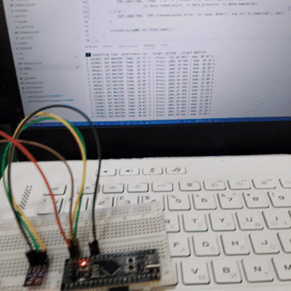

# emb16-homework

## SPI: Робота із сенсором BME280 по шині SPI

### Хід роботи:
1. Зібрано апаратну систему, що об'єднує метеодатчик BME280 та STM32 через I2C, STM32(master) та ESP32(slave) через SPI.
2. У проєкті реалізовано багаторівневу модульну архітектуру та взаємодію між пристроями:
   - Зчитування датчика та інтеграція бібліотеки: Задіяно офіційний драйвер [Bosch BME280 Sensor API](https://github.com/boschsensortec/BME280_SensorAPI). У файлі [main.c](Src/main.c) налаштовано шину I2C для опитування BME280, обробки калібрувальних коефіцієнтів та формування пакету даних (`bme280_packet_t`);
   - SPI Slave на STM32: Налаштовано периферію SPI1 у режимі ведомого (Slave) із застосуванням кільцевого контролера DMA, що забезпечує автоматичну та безперервну трансляцію актуальних показників у шину;
   - SPI Master на ESP32-S3: Реалізовано роботу мікроконтролера у ролі master, який періодично ініціює транзакції для збору даних від slave STM32;
   - Консольний вивід: Налаштовано прийняття структурованих бінарних даних, їхню десеріалізацію та стабільне логування поточних значень температури, тиску й вологості в термінал.

### Результат:
Опановано організацію міжпроцесорного зв'язку за допомогою протоколу SPI у режимі Master-Slave із застосуванням DMA. Успішно запущено апаратний конвеєр передачі даних: датчик BME280 опитується STM32 через I2C, після чого дані миттєво доставляються по SPI на ESP32-S3 для фінальної обробки та виведення в консоль.

Приклад роботи системи надано у .gif-анімації

